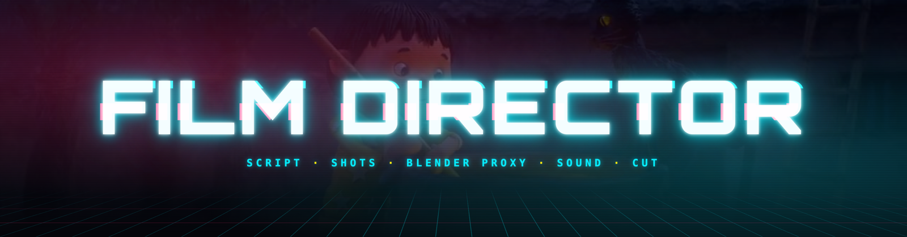
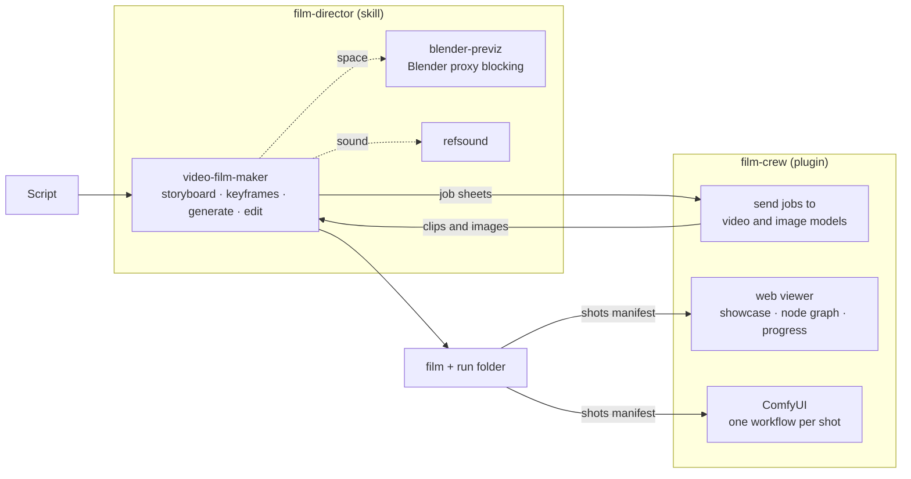

<div align="center">
  
</div>

<h1 align="center">Agent as Director: Cuts, Blender Proxies and Sound, from Script to Film</h1>

<p align="center">
  <a href="https://memoryoffish.github.io/film-director-page/"></a>
  <a href="https://memoryoffish.github.io/film-director-page/#promo"></a>
  <a href="https://memoryoffish.github.io/2026/11/22/film-director/"></a>
  <a href="#install"></a>
  <a href="LICENSE"></a>
</p>

<p align="center"><b>English</b> · <a href="README.md">中文</a></p>

https://github.com/user-attachments/assets/5f7ced7c-2008-4ca4-a46f-a5e1711ee11f

<p align="center"><sub>The 3-minute promo: Claude is handed the skill and directs four short films; all the film footage in it comes from real runs.</sub></p>

**Film Director lets an agent shoot a film the way a director would.**<br>
It decides what the audience should see before anything is generated, blocks the space with a Blender proxy, generates and checks the film shot by shot, and cuts it with sound.

## Highlights

<table>
  <tr>
    <td width="50%"><b>🎬 Shots and cuts</b><br>A shot list before any generation: what each shot shows, how long it holds, and how every cut joins, with a transitions library of worked examples.</td>
    <td width="50%"><b>🧊 Blender proxy</b><br>Positions, facing, cameras and door directions are blocked in Blender first. The renders guide the video model, and the film is checked against them.</td>
  </tr>
  <tr>
    <td width="50%"><b>🔊 Sound and edit</b><br>Sound effects picked from Freesound by what listeners left behind, CC0 and CC-BY only with attribution, then cut against the picture.</td>
    <td width="50%"><b>✂️ Post and repair</b><br>Trims, seams and takes are joined into one scene, and every shot's inputs stay open to inspect on a web page or as a ComfyUI workflow.</td>
  </tr>
</table>

## How it works



The skill is the method: it turns a script into a plan, keyframes and job sheets, checks every clip, and cuts the film. The plugin is the crew around it: it sends the job sheets to the models and shows what each shot was made from.

## What's inside

| | Name | Parts |
| --- | --- | --- |
| **Skill** | [film-director](skills/film-director) | **video-film-maker**: script to film in four steps (storyboard, casting and keyframes, generation and checks, edit), with a transitions library and worked examples. Model-agnostic, with notes for Wan 3.0 and Seedance 2.5 (the two vendors' official prompt guides are downloaded separately, see `skills/film-director/video-film-maker/refs/practical/prompt-skills/overview.md`).<br>**blender-previz**: block a scene as a proxy in Blender (positions, facing, cameras, timing), turn it into references for the video model, check the film against it.<br>**refsound**: pick sound effects or reference recordings from Freesound using signals left by people who listened. CC0 and CC-BY only, with attribution. |
| **Plugin** | [film-crew](plugins/film-crew) | **backends**: send job sheets to video and image models and bring the results back, with a record of every generation.<br>**viewer**: a web page for a run, each shot's inputs next to the seconds it became, a node graph, and a progress page while the film is being made.<br>**comfyui**: open each shot in ComfyUI as its own workflow, replay only, with the assets left for a person to take over.<br>**formats**: the two hand-off formats (job sheet, shots manifest) these parts share. |

The skill works without the plugin.

## Install

One command for the skill, one for the plugin:

```bash
npx skills add memoryoffish/film-director-skill-plugin                                  # the skill
claude plugin install film-crew --marketplace memoryoffish/film-director-skill-plugin   # the plugin (optional, Claude Code)
```

- **The skill** is installed with the open [`skills`](https://github.com/vercel-labs/skills) installer (needs Node.js). It puts `skills/film-director` into your agent's skills directory, and works for Claude Code, Codex and other agents that read `SKILL.md`. The installer asks which agent to install for, and whether for this project or for your user; to skip the questions and install for Claude Code at user level: `npx skills add memoryoffish/film-director-skill-plugin -a claude-code -g -y`.
- **The plugin** is installed by Claude Code itself: the command adds this repo as a plugin marketplace if it is not added yet, then installs.
- Without Node.js, Claude Code can also take the skill as a plugin: `claude plugin install film-director --marketplace memoryoffish/film-director-skill-plugin`. If your Claude Code does not know `--marketplace`, run `claude plugin marketplace add memoryoffish/film-director-skill-plugin` first, then `claude plugin install film-director@film-director` or `claude plugin install film-crew@film-director`.

**By hand.** `skills/film-director` and `plugins/film-crew` are each a folder with one `SKILL.md` at its root, so any agent that reads that format can use them. Copy or link them into the agent's skills directory, for example `~/.claude/skills/` or `~/.agents/skills/`.

**Requirements.**
- Python 3.10+ with numpy and opencv-python, and ffmpeg. Running the tests also needs pytest.
- The Blender proxy part needs Blender 5.3 (`pip install bpy==5.3.0`, which wants Python 3.13). Other versions are untested.
- Your own keys, as environment variables: `DASHSCOPE_API_KEY` for Wan 3.0 on Alibaba Cloud Model Studio, and `OPENAI_API_KEY` (optionally `OPENAI_BASE_URL`) for keyframe images. Nothing in this repo holds a key.

## Quick start

Put a script in a folder and ask the agent, for example:

> Use film-director to make a 60-second film from `script.md`. Block the scenes where positions matter in Blender first.

1. The agent reads `skills/film-director/SKILL.md` and writes a plan with a shot list.
2. It writes a job sheet for every generation and sends it to the video model, either with the skill's own scripts or, if film-crew is installed, through its backends (`request` shows exactly what would be sent before anything is spent).
3. It checks each clip as it comes back, re-shoots what is wrong, and cuts the film.
4. To look at the run with film-crew's viewer or in ComfyUI, the run folder also needs a shot table (`meta.json`: which job each shot came from and where it sits in the film). Ask the agent to write it after the cut; the format is in `plugins/film-crew/formats/`.

## Acknowledgements

The methods here draw on public tutorials and open-source projects, and each one is credited where it is used: the sources of every transition and editing rule are in `skills/film-director/video-film-maker/refs/background/sources/by-method.md`, and the origin of refsound's selection rules is in `skills/film-director/refsound/GUIDE.md`.

The Freesound recordings used in the promo are credited in [CREDITS.md](CREDITS.md).

## License

[Apache-2.0](LICENSE). Third-party assets keep their own licenses: the KayKit furniture models in `skills/film-director/blender-previz/assets/` are CC0 (see the `LICENSE.txt` there).

This project is not affiliated with or endorsed by Anthropic. Claude is a trademark of Anthropic.
