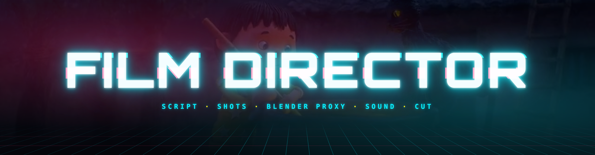
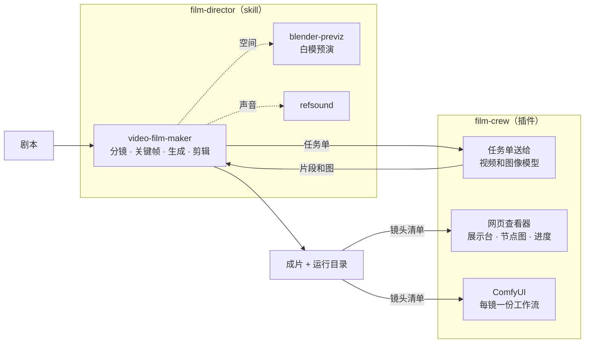

<div align="center">
  
</div>

<h1 align="center">Agent 当导演：切镜、白模、音效剪辑，从剧本拍到成片</h1>

<p align="center">
  <a href="https://memoryoffish.github.io/film-director-page/"></a>
  <a href="https://memoryoffish.github.io/film-director-page/#promo"></a>
  <a href="https://memoryoffish.github.io/2026/11/22/film-director/"></a>
  <a href="#安装"></a>
  <a href="LICENSE"></a>
</p>

<p align="center"><a href="README.en.md">English</a> · <b>中文</b></p>

https://github.com/user-attachments/assets/5f7ced7c-2008-4ca4-a46f-a5e1711ee11f

<p align="center"><sub>3 分钟宣传片：Claude 拿到这份 skill，当导演拍了四部短片，其中的影片画面都出自真实运行。</sub></p>

**Film Director 让 agent 像导演一样拍片。**<br>
生成之前先想清楚观众该看见什么，用 Blender 白模把空间定准，再一镜一镜生成、检查，最后配上声音剪成片。

## 特点

<table>
  <tr>
    <td width="50%"><b>🎬 切镜</b><br>生成之前先排镜头表：每一镜拍什么、停多久、每一刀怎么接；接法库里每种接法都有实拍案例。</td>
    <td width="50%"><b>🧊 白模</b><br>站位、朝向、机位、门往哪开，先在 Blender 里定准；白模的渲染图喂给视频模型，成片也对着它查。</td>
  </tr>
  <tr>
    <td width="50%"><b>🔊 音效剪辑</b><br>照听过的人留下的信号从 Freesound 挑音效，只取 CC0 和 CC-BY、带署名，再对着画面剪进去。</td>
    <td width="50%"><b>✂️ 后期片段剪辑</b><br>挑条、修剪、处理接缝，把几段接成一场戏；每一镜喂了什么，都能在网页或 ComfyUI 工作流里打开看。</td>
  </tr>
</table>

## 怎么运作



skill 是方法：把剧本变成计划、关键帧和任务单，检查每段片子，剪成片。插件是方法身边的剧组：把任务单送给模型，把每一镜是用什么做出来的摆给人看。

## 里面有什么

| | 名字 | 几部分 |
| --- | --- | --- |
| **Skill** | [film-director](skills/film-director) | **video-film-maker**：剧本到成片的四步（分镜、定妆与关键帧、生成与检查、剪辑），带接法库和实拍案例。做法和具体模型无关，另有 Wan 3.0、Seedance 2.5 的写法说明（两家的官方提示词指南需另下载，见 `skills/film-director/video-film-maker/refs/practical/prompt-skills/overview.md`）。<br>**blender-previz**：在 Blender 里把一场戏搭成白模（位置、朝向、机位、时间），变成视频模型的参考，成片对着白模查。<br>**refsound**：从 Freesound 挑音效或参考录音，依据是听过的人留下的信号。只取 CC0 和 CC-BY，带署名。 |
| **插件** | [film-crew](plugins/film-crew) | **backends**：把任务单送给视频和图像模型、取回结果，每次生成都留记录。<br>**viewer**：把一次拍片做成网页，每一镜的输入和它在成片里的那几秒并排放，还有节点图和拍片进行中的进度页。<br>**comfyui**：每一镜在 ComfyUI 里打开成一份工作流，只回放，资产留给人接手。<br>**formats**：这几部分共用的两份交接格式（任务单、镜头清单）。 |

不装插件，skill 也能独立用。

## 安装

skill 一条命令，插件一条命令：

```bash
npx skills add memoryoffish/film-director-skill-plugin                                  # skill
claude plugin install film-crew --marketplace memoryoffish/film-director-skill-plugin   # 插件（可选，Claude Code）
```

- **skill** 用开源的 [`skills`](https://github.com/vercel-labs/skills) 安装器装（要有 Node.js）。它把 `skills/film-director` 放进 agent 的 skills 目录，Claude Code、Codex 和其他认 `SKILL.md` 的 agent 都能用。安装器会问装给哪个 agent、装到当前项目还是用户目录；不想被问、直接给 Claude Code 装到用户目录：`npx skills add memoryoffish/film-director-skill-plugin -a claude-code -g -y`。
- **插件** 由 Claude Code 自己装：这条命令会先把这个仓库登记成插件市场（还没登记的话），再安装。
- 没有 Node.js 时，Claude Code 也可以把 skill 当插件装：`claude plugin install film-director --marketplace memoryoffish/film-director-skill-plugin`。你的 Claude Code 不认 `--marketplace` 时，先跑 `claude plugin marketplace add memoryoffish/film-director-skill-plugin`，再跑 `claude plugin install film-director@film-director` 或 `claude plugin install film-crew@film-director`。

**手动装。** `skills/film-director` 和 `plugins/film-crew` 都是根上只有一个 `SKILL.md` 的文件夹，认这种格式的 agent 都能用。把它们拷贝或软链接到 agent 的 skills 目录，比如 `~/.claude/skills/`、`~/.agents/skills/`。

**需要什么。**
- Python 3.10+，装 numpy 和 opencv-python；还要 ffmpeg。跑测试另需 pytest。
- 白模那部分要 Blender 5.3（`pip install bpy==5.3.0`，要 Python 3.13）；别的版本没测过。
- key 用自己的，放在环境变量里：`DASHSCOPE_API_KEY`（阿里云百炼的 Wan 3.0），`OPENAI_API_KEY`（关键帧出图，可另设 `OPENAI_BASE_URL`）。仓库里不带任何 key。

## 上手

把剧本放进一个文件夹，对 agent 说，比如：

> 用 film-director 把 `script.md` 拍成一部 60 秒的短片，位置要紧的戏先在 Blender 里搭白模。

1. agent 读 `skills/film-director/SKILL.md`，先写计划和镜头表。
2. 每一次生成写一份任务单，交给视频模型：用 skill 自带的脚本，或者装了 film-crew 的话交给它的后端（`request` 先把要发的请求原样打出来，看过再花钱）。
3. 每段片子回来马上检查，不对的重拍，最后剪成片。
4. 要用 film-crew 的查看器或在 ComfyUI 里看这次拍片，运行目录里还要有一份镜头表（`meta.json`：每一镜出自哪个任务、在成片里的起止）。剪完让 agent 照分镜和剪辑结果写一份；格式在 `plugins/film-crew/formats/`。

## 致谢

这里的做法借鉴了不少公开教程和开源项目，出处都写在用到的地方：各接法、剪辑规则的出处见 `skills/film-director/video-film-maker/refs/background/sources/by-method.md`，refsound 选材规则的来源见 `skills/film-director/refsound/GUIDE.md`。

宣传片里用到的几段 Freesound 录音，署名见 [CREDITS.md](CREDITS.md)。

感谢 [LINUX DO](https://linux.do/) 提供技术交流与开源分享的社区空间。

## 许可证

[Apache-2.0](LICENSE)。第三方资产保留各自的许可：`skills/film-director/blender-previz/assets/` 里的 KayKit 家具模型是 CC0（见该目录的 `LICENSE.txt`）。

本项目与 Anthropic 无关，非 Anthropic 官方项目。Claude 是 Anthropic 的商标。
